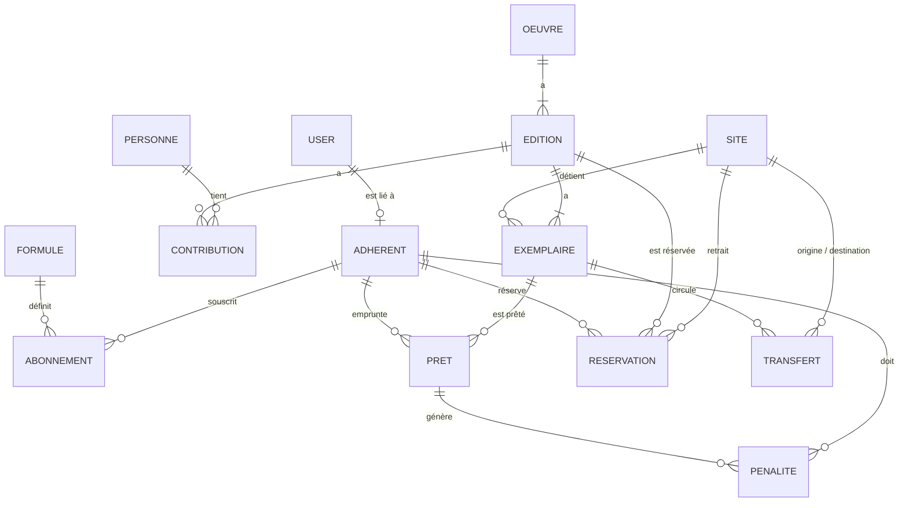

# Modèle de données — Réseau de médiathèques

Ce document décrit le modèle de données (Doctrine / MySQL 8) et justifie les choix principaux.
Les réponses détaillées aux « Questions à trancher » sont dans `DECISIONS.md`.

## Diagramme

## Entités

### Catalogue

| Entité | Rôle | Champs principaux |
|---|---|---|
| **Oeuvre** | L'œuvre « abstraite » (le roman, la BD, le film) | titre, titre original, type (`LIVRE`, `BD`, `DVD`), description |
| **Edition** | Une publication précise d'une œuvre | isbn (unique, nullable), éditeur, année, langue, nombre de pages, couverture (URL), oeuvre |
| **Personne** | Auteur, traducteur, illustrateur, réalisateur… | nom, prénom |
| **Contribution** | Lien Edition ↔ Personne avec un rôle | edition, personne, rôle (`AUTEUR`, `TRADUCTEUR`, `ILLUSTRATEUR`, `REALISATEUR`…) |
| **Exemplaire** | Copie physique d'une édition | code-barres (unique), edition, site courant, site d'origine, état (`BON`, `ABIME`), statut |
| **Site** | Une des médiathèques | nom, adresse |

Statuts d'un exemplaire : `DISPONIBLE`, `EMPRUNTE`, `MIS_DE_COTE` (réservé en attente de retrait), `EN_TRANSIT`, `PERDU`, `RETIRE`.

### Adhérents et abonnements

| Entité | Rôle | Champs principaux |
|---|---|---|
| **User** | Compte de connexion | email (unique), mot de passe haché, rôles (`ROLE_ADHERENT`, `ROLE_BIBLIOTHECAIRE`, `ROLE_ADMIN`) |
| **Adherent** | Personne inscrite | nom, prénom, email, téléphone, date d'inscription, user (nullable) |
| **Formule** | Type d'abonnement et ses règles | nom, prix, max de prêts simultanés, durée de prêt (jours), prolongations max, tarif de pénalité par jour |
| **Abonnement** | Formule souscrite par un adhérent sur une période | adherent, formule, date de début, date de fin |

### Mouvements

| Entité | Rôle | Champs principaux |
|---|---|---|
| **Pret** | Un emprunt d'un exemplaire | exemplaire, adherent, site d'emprunt, date d'emprunt, date d'échéance, date de retour (nullable), nombre de prolongations |
| **Reservation** | Une demande en file d'attente sur une édition | edition, adherent, site de retrait, date de demande, statut (`EN_ATTENTE`, `A_RETIRER`, `HONOREE`, `ANNULEE`, `EXPIREE`), exemplaire réservé (nullable), date limite de retrait (nullable) |
| **Penalite** | Pénalité financière | adherent, pret, motif (`RETARD`, `PERDU`, `ABIME`), montant, date, payée (bool) |
| **Transfert** | Déplacement d'un exemplaire entre sites | exemplaire, site d'origine, site de destination, date d'envoi, date de réception (nullable) |

## Choix de conception

1. **Oeuvre → Edition → Exemplaire** : trois niveaux. Plusieurs éditions d'un même roman partagent la même œuvre, et chaque édition peut avoir plusieurs copies physiques réparties entre les deux sites.
2. **Contribution** plutôt qu'un simple champ « auteur » : une édition peut avoir plusieurs auteurs, un traducteur, un illustrateur. Le rôle est porté par la relation.
3. **Formule séparée de l'Abonnement** : les règles (nombre de prêts, durée, tarif de pénalité) sont des données modifiables en back-office, pas du code. L'abonnement garde l'historique de ce que l'adhérent a souscrit.
4. **Réservation portée par l'édition**, avec un site de retrait : la file d'attente se calcule par `date de demande` croissante parmi les réservations `EN_ATTENTE` d'une même édition. Aucun champ « position » à maintenir.
5. **Statut d'un prêt déduit** : un prêt est en cours tant que `date de retour` est nulle, et en retard si l'échéance est dépassée. On évite un champ redondant qui pourrait devenir incohérent.
6. **Transfert** explicite : on garde la trace de chaque circulation d'un exemplaire, et l'exemplaire est `EN_TRANSIT` pendant le déplacement.
7. **User distinct d'Adherent** : un bibliothécaire ou un administrateur est un `User` sans fiche adhérent.

## Contraintes d'intégrité

- `Exemplaire.code_barres` et `Edition.isbn` sont uniques.
- Un exemplaire ne peut avoir qu'un seul prêt sans date de retour à la fois.
- Un adhérent ne peut pas dépasser le maximum de prêts simultanés de sa formule en cours de validité (vérifié dans le service métier, couvert par des tests).
